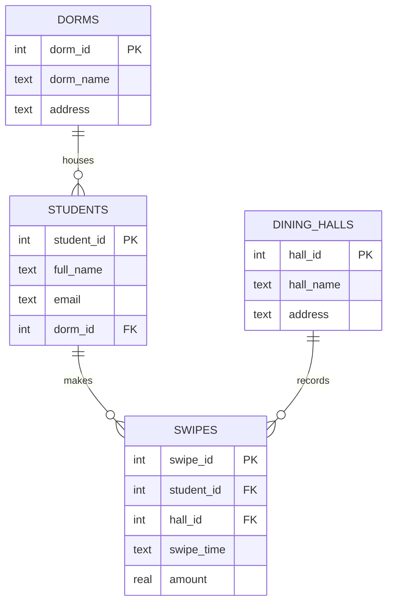
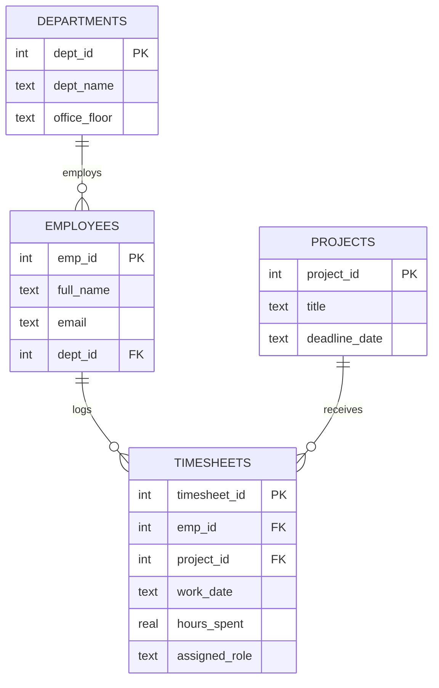

# SQL: Joins and Subqueries

Analytical SQL queries on two SQLite databases: a **university dining** system (meal-card swipes) and a **company project allocation** system (employee timesheets). Every query answers a real business question using multi-table `JOIN`s, aggregation and subqueries.

## Databases

### University Dining



### Project Allocation



## Questions answered

| Database | Question | Techniques |
|---|---|---|
| Dining | Total spent by Einstein Hall students at North Cafeteria | 4-table `JOIN`, `SUM` |
| Dining | Number of distinct students who ate there | `COUNT(DISTINCT …)` |
| Dining | Students who **never** ate there | `NOT IN` subquery |
| Dining | Students spending above the campus average per meal | `GROUP BY` + `HAVING` with subquery |
| Projects | Hours the IT department spent on Cloud Migration | 4-table `JOIN`, `SUM` |
| Projects | Distinct R&D employees on Mobile App v2 | `COUNT(DISTINCT …)` |
| Projects | Marketing employees **not** on Global Marketing Drive | `NOT IN` subquery |
| Projects | Everyone on the project with the most logged hours | subquery with `ORDER BY … LIMIT 1` |

All queries are in [`queries/`](queries/).

## How to run

Open the `.sqlite` files in [DB Browser for SQLite](https://sqlitebrowser.org/) or DataGrip and paste a query, or run all of them at once with Python (standard library only):

```bash
python run_queries.py                      # all queries
python run_queries.py university_dining    # one database
```

## Example output

```
Q4. Which Marie Curie Quad students spend more per meal than the campus average?
  full_name  | avg_meal_cost
  -----------+--------------
  Mila Adams | 13.17
  (1 row)
```

## What I practised

Joining several tables through foreign keys, the difference between `WHERE` and `HAVING`, correlated vs. scalar subqueries, and finding "missing" records with `NOT IN`.
